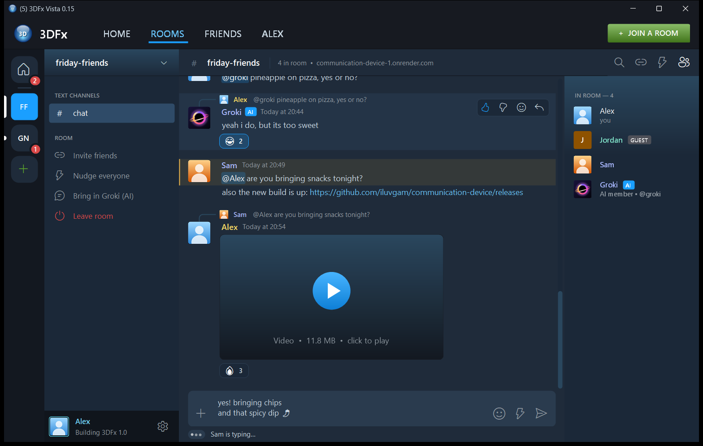

# 3DFx Vista 0.15

Windows group chat using room names and passwords. No invitation strings, IP copying, local discovery, incoming connections on laptops, or self-signed chat certificates.

## Run the app

Download **3DFxVista-win-Setup.exe** from Releases and run it: it installs for your Windows user only (no admin), adds a Start menu shortcut and an uninstaller, and from then on the app offers updates itself. (Prefer no install? Use **3DFxVista-win-Portable.zip**; portable copies do not update themselves.) Open 3DFx Vista on both laptops. Use the same trusted relay HTTPS address, room name and password. One person uses **+ > Create room**, the friend **+ > Join room**. Passwords must be 10–128 characters; use a unique phrase shared privately. Room names are 3–32 ASCII letters/numbers/hyphens and are case-insensitive. Passwords are case-sensitive. Groki, the AI member (optional, formerly Bryan): type **@groki** in a room and he joins within a few seconds; add **groki** as a friend to DM him. He is always labelled "Groki (AI)" / with an AI badge, and his picture is a black hole. He runs on the operator's own PC and everyone reaches him through the relay (he is not part of this download); the relay only lets that service sign in as him (Render environment variable **BotKey**, at least 16 random characters) and gives him a one-time pass into a room when someone calls him, so he never needs room passwords. Without BotKey the names "groki" and "bryan" are still reserved and @groki does nothing. Hover one of his messages for thumbs up / down; he learns from them.

The window: a chat-app layout in Steam-style steel blues. Across the top, Steam-style navigation (HOME, ROOMS, FRIENDS, your name) and a green **JOIN A ROOM** button. Friends are grouped Online / Offline with square pictures framed in their status colour (blue online, grey offline), and a pop-up in the corner says when a friend comes online. Far left, the **rail**: Home (the 3DFx orb), one round icon per room you're in (several at once; a white pill marks unread, a red count marks mentions of you), and **+** to join or create a room (Ctrl+K; Alt+Up / Alt+Down switch rooms). Enter sends; Shift+Enter starts a new line. Ctrl+F searches the open conversation. Settings > Windows Settings has Close to the system tray (on by default: closing keeps you online; right-click the tray icon to quit), Start with Windows, and Reopen my rooms; Settings > Appearance sets the chat text size. Motion is smooth and Apple-style (turn off Windows' "Animation effects" to switch it off). Links in messages open in your browser; drag across text to select it (Ctrl+C copies). Click a name or picture for a profile card. A red NEW line shows where unread messages start, and while 3DFx is in the background, DMs, @mentions and nudges show a Windows notification (Settings > Notifications). Next, the **sidebar**: on Home, Friends and your direct messages; in a room, its menu (invite, nudge, bring in Groki, leave). At the bottom, **you**: click your picture for status (Online / Away / Busy / Appear offline), custom status and avatar; the gear opens **Settings** (account, profile, notifications, privacy, connection, about). In a room the **member list** is on the right (toggle with the people icon); Groki shows an **AI** badge, guests a **GUEST** badge.

Log in: the start screen asks for the relay address, username and password (**Register** and **Forgot your password?** are there too), or **Continue as guest** with just a name (guests get rooms only). "Keep me signed in" stores the sign-in encrypted for your Windows user only; the password is never saved. At sign-up you get a one-time **recovery key** (save or print it). Settings > My Account changes the password, makes a new recovery key, or deletes the account. After 5 wrong passwords, each further try must wait (30 seconds, doubling up to 15 minutes). Signed-in people appear in rooms under their verified username; guests show with a GUEST badge.

Friends and DMs (signed in): Home > **Friends** has Online / All / Pending / Blocked and **Add Friend** (by username; they accept first). Click a friend to open the DM in the main window (text, smileys, stickers, pictures up to 5 MB). You see "Sam is typing...", then **Delivered** once their app has saved your message and **Seen** once they've looked at it (turn off in Settings > Privacy; you then also stop seeing it). A DM to someone offline waits on the relay's disk until one of their apps confirms it arrived (at most 30 days). DM history is kept on your own PC, encrypted for your Windows user; right-click a conversation to clear it. The relay can read DMs (not end-to-end encrypted yet). Only friends see your picture, status and status line; Appear offline looks exactly like offline; Away switches on by itself after 10 idle minutes.

Media: send **pictures** (the **+** in the message box, paste with Ctrl+V, or drag onto the chat; shrunk to 1920 px and re-saved, which removes hidden GPS data), **videos** up to 25 MB (MP4 or WebM, played inside the app), and built-in **stickers** (smiley button). Click a picture or video in the chat to open it; **Save…** is the only way media is written to disk. The relay forwards media piece by piece and never stores it, but it can read it. Video playback uses Microsoft Edge WebView2 (built into Windows 11) with scripts off. Extras: **Nudge** shakes everyone's window (one per 15 s per person), a ☺ smiley picker, "Sam is typing…", an unread count on the taskbar button, and an optional Windows startup sound. Nudge and typing need the 0.6 relay, media and stickers the 0.7 relay; with an older relay those features simply stay off. A room stays open while anyone is in it; it ends when the last person leaves. The member list shows who is there. After a lost connection, a red bar offers **Rejoin**.

**A deployed relay is required. This source package does not include a running public relay or account.** A GitHub Release distributes the app; GitHub Pages cannot run this relay. The laptops need internet access; they no longer need the same hotspot. A relay address is shared once, not a room invitation code.

## Accounts need a Render disk

Accounts are stored in one small file, `/var/data/accounts.db`, on a Render persistent disk: usernames, salted password hashes, recovery-key hashes, hashes of sign-in tokens, contact lists, and DMs that are waiting for delivery (deleted once delivered, or after 30 days). Room messages and room media are never written to disk; while a room is open the relay keeps its last 100 messages in memory (for late joiners, edits and reactions) and forgets them when the room ends. In the Render dashboard: your service → **Disks** → **Add disk**, mount path `/var/data`, 1 GB. Without the disk, accounts simply stay off and everyone joins as before. `https://<your relay>/health` shows `"accounts":"on"`, `"off"` or `"error"`.

## Deploy the relay on Render

1. Upload this source folder's CONTENTS to a GitHub repository root: Dockerfile, render.yaml, Relay, Shared, Client, Tests and this README should appear there. Do not upload build folders.
2. Sign in to Render at https://dashboard.render.com/ and choose **New > Web Service**. Connect the GitHub repository. Choose the Docker runtime, root directory blank, Dockerfile path ./Dockerfile. Select the service plan you want after reviewing its terms/cost. A free-plan blueprint is also included in render.yaml; no plan is purchased or service deployed by this package.
3. Deploy. Wait for the service to be live. Open the provided https://...onrender.com address; it should say the relay is running.
4. Enter that SAME HTTPS address in 3DFxVista.exe on both laptops. Use the root address without /chat. The app uses secure WebSockets internally.

Render terminates public HTTPS and forwards requests to the container. The container listens on port 10000. Use exactly one running instance: state is in memory and is not shared between instances. Free-tier services may sleep; the client waits up to 90 seconds for connection. Restarts, redeploys, or service shutdowns erase all rooms. Do not expect durable sessions or high availability.

Official hosting references: https://render.com/docs/web-services and https://render.com/docs/websocket

## Security and Norton

The app uses Windows/.NET's normal certificate validation against the trusted HTTPS relay hostname. It does not override certificate validation, install roots, change Norton, change firewall settings or disable protections. Participants verify the relay address through a trusted channel and their normal HTTPS trust chain; the room password controls admission. A valid certificate for a different or malicious relay is not proof you chose the correct service: check the address.

This avoids the previous local inbound firewall and self-signed certificate design. Norton or organizational policy may still block or inspect HTTPS/WebSockets; compatibility is not guaranteed. Follow the device owner's approved process if blocked. Do not disable protection. Software trusted by Windows to inspect HTTPS can read that traffic.

The relay operator can read messages and room passwords during authentication. This is transport encryption, not end-to-end encryption. No identities/accounts or moderation system are provided; display names can be duplicated. A wrong room/password receives a generic rejection. Passwords are stored only as salted PBKDF2-SHA256 verifiers (600,000 iterations) in relay memory; active request objects may temporarily hold plaintext. Use a unique room password, never an account password.

There is no message database, message-body logging, or history replay. Clients keep bounded visible history in memory; it stays visible after a lost connection and is cleared when you click Disconnect. Relay memory stores active rooms and sockets. Hosting platforms may retain connection/access logs or crash dumps; operating-system paging, screenshots and clipboard sharing are outside the app's guarantee. The app never saves the password or room name. If you tick "Remember relay and name", the relay address, display name and sound choice are saved in %LOCALAPPDATA%\3DFx\settings.json; unticking deletes that file.

Prototype limits: 16 participants per room, approximately 64 rooms, 128 concurrent connections, two concurrent password checks, 20 WebSocket connection attempts per remote IP per minute, 30 messages per participant per ten seconds, 2,000 characters per message, 16 KiB framed packet limit. Behind a proxy, multiple users may share a rate-limit bucket. Public hosting is not private access control: anyone knowing the relay URL can attempt room creation, subject to limits. Use a private small-group instance; this has not had a production security audit.

## Build

Requires Windows x64 and .NET 10 SDK for the client:

    dotnet publish Client/3DFx.csproj -c Release -r win-x64 --self-contained true -p:PublishSingleFile=true -p:IncludeNativeLibrariesForSelfExtract=true -p:DebugType=None -o artifacts/app

The relay uses the included Dockerfile or:

    dotnet run --project Relay/Relay.csproj --urls http://127.0.0.1:45903 --ConnectionsPerMinute=500 --AccountsPerMinute=500 --AccountsDb=%TEMP%\3dfx-test-accounts.db --BotKey=test-bot-key-0123456789

That last command is for LOCAL TESTS ONLY. Never use plaintext HTTP for participants or expose that test listener publicly. For public use deploy behind trusted HTTPS as above.

In a second terminal, from the same source folder:

    dotnet run --project Tests/Tests.csproj -c Release

After deploying, check the live relay (about 6 connections, random throwaway room):

    dotnet run --project Tests/Tests.csproj -c Release -- https://your-relay.onrender.com

112 loopback tests pass (TEST-RESULTS.txt): rooms, accounts, friends and DMs, media, replies/edits/reactions, room history, the AI member and feedback, malformed input, relay address pastes and form field checks. `--ConnectionsPerMinute=500` is for local tests only; the deployed default stays 20. They use unencrypted loopback WebSockets and synthetic passwords to test relay behavior. Public TLS deployment, Docker execution and two-device behavior have not been tested here. Test those after deployment before relying on it. The client and relay compiled successfully.

## Publish a release (installer and updates)

Build (from this folder): publish as above, then `dotnet vpk pack --packId 3DFxVista --packVersion <x.y.z> --packDir artifacts/app --mainExe 3DFxVista.exe --packTitle "3DFx Vista" --packAuthors "3DFx" --icon Client/3DFxVista.ico --outputDir artifacts/release` (vpk is a local tool: `dotnet tool restore` installs it). On GitHub, in iluvgam/communication-device: **Releases → Draft a new release**, tag `<x.y.z>` (like the earlier releases, e.g. `0.15.0`), and attach **every** file from `artifacts/release` (Setup.exe, Portable.zip, the .nupkg, releases.win.json, assets.win.json, RELEASES). Publish it as a normal release (not a pre-release). Installed copies find it at their next start and ask before downloading. Keep earlier .nupkg files in `artifacts/release` when packing the next version so vpk can also make a small "delta" update. The installer is not code-signed, so Windows SmartScreen will warn the first time.

Uploading source alone does not start the relay. Send friends the release link plus the deployed relay address. Share the room name and unique password privately.

